# Communauté Le Revenu

Espace communautaire des lecteurs du **Revenu** : on y consulte des discussions par catégorie, on ouvre une discussion
pour lire les réponses, on publie des questions et des réponses, on vote « Utile » et l'auteur choisit la meilleure réponse.

**Stack imposée** : Next.js 16 (App Router, React 19, TypeScript, Tailwind CSS 4) · Strapi v5 (TypeScript, API REST) · PostgreSQL 16.

> Réalisé par **LAMJED GAIDI** — lamjed.gaidi070@gmail.com


---

## Sommaire

1. [Ce qui est livré](#ce-qui-est-livré)
2. [Démarrage rapide](#démarrage-rapide)
3. [Architecture](#architecture)
4. [Captures d'écran](#captures-décran)
5. [Tests](#tests)
6. [Structure du dépôt](#structure-du-dépôt)
7. [Documentation détaillée](#documentation-détaillée)

---

## Ce qui est livré

| Exigence du sujet | Réalisation | Où regarder |
| --- | --- | --- |
| **A. Accueil** — discussions issues de Strapi, titre / auteur / catégorie / nb de réponses / date, filtre par catégorie, tri par date, lien vers le détail | Server Component alimenté par `GET /api/discussions` ; filtres, tri, recherche et page dans l'URL | `frontend/src/app/page.tsx` |
| **B. Détail** — URL propre, contenu, auteur, date, catégorie, réponses, publication d'une réponse | `/discussions/[slug]`, réponses triées, formulaire en Server Action enregistré dans PostgreSQL via Strapi | `frontend/src/app/discussions/[slug]` |
| **C. Création** — titre ≥ 10 caractères, contenu obligatoire, catégorie, type, erreurs affichées, redirection | Validation côté navigateur **et** côté Strapi (yup), erreurs Strapi affichées par champ, redirection vers la nouvelle discussion | `backend/src/api/discussion/validation.ts` |
| **D. Utilisateurs et permissions** — auteur obligatoire, refus des anonymes, pas d'usurpation, permissions côté Strapi | Users & Permissions ; auteur imposé par le serveur ; policies `is-authenticated` / `is-not-impersonating` / `is-discussion-author` ; permissions déclarées dans le code | `backend/src/policies`, `backend/src/bootstrap/permissions.ts` |
| **Architecture Strapi** — User, Category, Discussion, Reply, relations, pagination et tri côté serveur, validation, erreurs HTTP cohérentes, Document Service | 4 content types (+ `Vote`), controllers fins, services sur le Document Service API, index PostgreSQL déclarés dans les schémas | [`docs/data-model.md`](docs/data-model.md), [`docs/api.md`](docs/api.md) |
| **Architecture Next.js** — composants réutilisables, appels Strapi centralisés et typés, Server vs Client Components, chargement / erreur / vide, responsive | Client Strapi unique `server-only`, composants client limités aux interactions (formulaires, vote), `loading.tsx` / `error.tsx` / `not-found.tsx` | [`docs/architecture.md`](docs/architecture.md) |
| **Tests** — validation, refus anonyme, usurpation, affichage | 20 tests d'intégration API, 13 tests unitaires frontend, 6 parcours Playwright | [`docs/testing.md`](docs/testing.md) |
| **Livrables** — PostgreSQL, schémas, données de démo, `.env.example`, README | Docker Compose, schémas versionnés, seed automatique (11 catégories, 18 membres, 20 discussions issues de la maquette) | ce fichier |

**Bonus réalisés** : recherche · pagination · votes « Utile » · meilleure réponse · tests Playwright · Docker Compose.

---

## Démarrage rapide

### Option 1 — tout en Docker (recommandé)

```bash
docker compose up --build
```

| Service | URL |
| --- | --- |
| Application | http://localhost:3000 |
| API Strapi | http://localhost:1337/api/discussions |
| Admin Strapi | http://localhost:1337/admin (créer le premier administrateur au premier accès) |
| PostgreSQL | `localhost:5434` — base `lerevenu`, utilisateur / mot de passe `lerevenu` |

Au premier démarrage, Strapi crée les permissions et les données de démonstration.

### Option 2 — en local (Node.js 20.19+ ou 22)

```bash
# 1. PostgreSQL seul (crée aussi la base de test lerevenu_test au premier lancement du volume)
docker compose up -d postgres

# 2. Backend Strapi → http://localhost:1337
cd backend
cp .env.example .env        # puis remplacer les secrets « changeme » (openssl rand -base64 32)
npm install
npm run develop

# 3. Frontend Next.js → http://localhost:3000 (autre terminal)
cd frontend
cp .env.example .env.local
npm install
npm run dev
```

### Comptes de démonstration

Tous les membres créés par le seed partagent le mot de passe `Demo1234!` (variable `DEMO_USER_PASSWORD`) :
`Thomas_PEA`, `Vincent_ETF`, `Odile.Retraite`, `Karim_Immo`, `PapyBoursier`, `LaRedaction`… La page `/connexion` propose
une connexion en un clic.

Pour repartir d'une base vierge : `docker compose down -v` puis relancer.

---

## Architecture

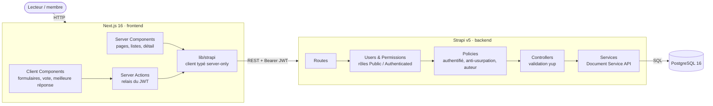

- **Le navigateur ne parle jamais à Strapi.** Toutes les requêtes passent par le serveur Next.js (Server Components pour
  lire, Server Actions pour écrire) qui ajoute le JWT de l'utilisateur, conservé dans un cookie `httpOnly`.
- **Next.js n'a aucune logique métier** : les Server Actions relaient la requête ; validation, autorisations et
  persistance sont dans Strapi. Next.js n'accède jamais à PostgreSQL.
- **Les règles sont appliquées deux fois côté Strapi** : permissions du rôle (Users & Permissions) puis policies et
  validation dans le controller.

Le parcours « créer une discussion », de bout en bout :

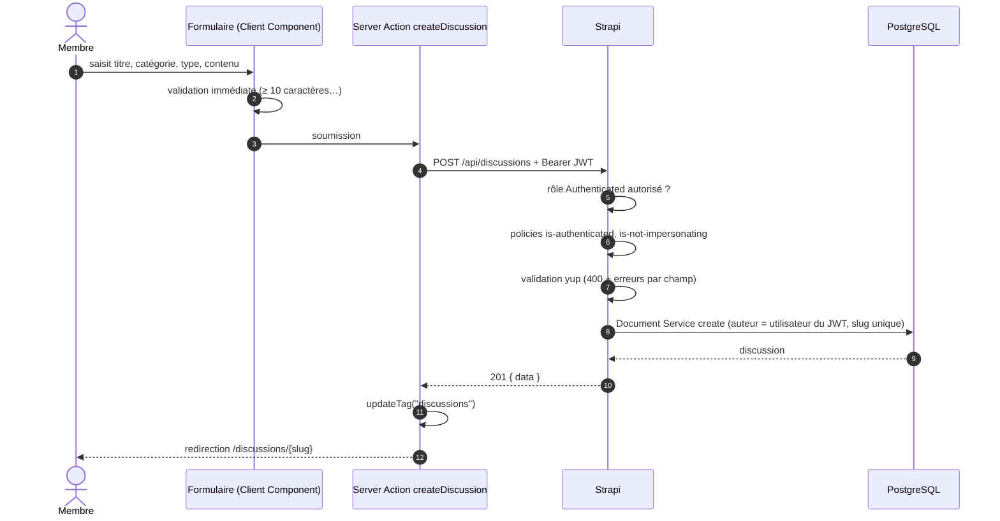

Détails, choix et alternatives écartées : [`docs/architecture.md`](docs/architecture.md) et [`docs/decisions.md`](docs/decisions.md).

### Modèle de données

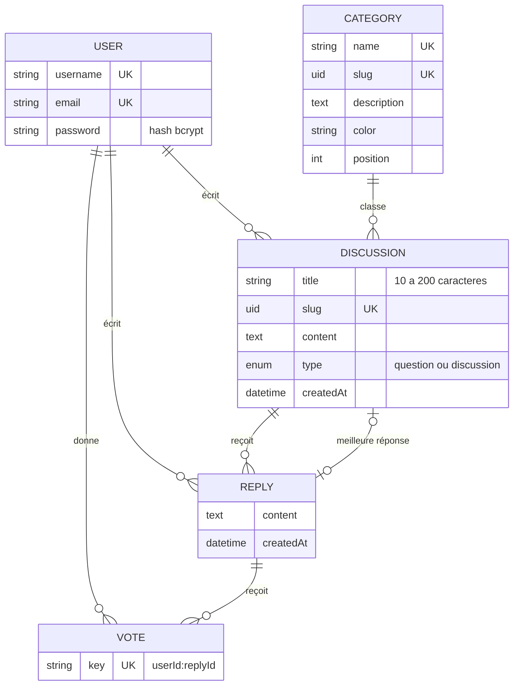

---

## Captures d'écran

Captures prises sur la stack Docker locale, avec un vrai compte membre **LamjedGaidi** (lamjed.gaidi070@gmail.com)
inscrit via `POST /api/auth/local/register` et un compte administrateur Strapi au même nom.

### Frontend (Next.js)

| Détail d'une discussion : meilleure réponse, votes, réponse | Validation du formulaire de création |
| --- | --- |
| 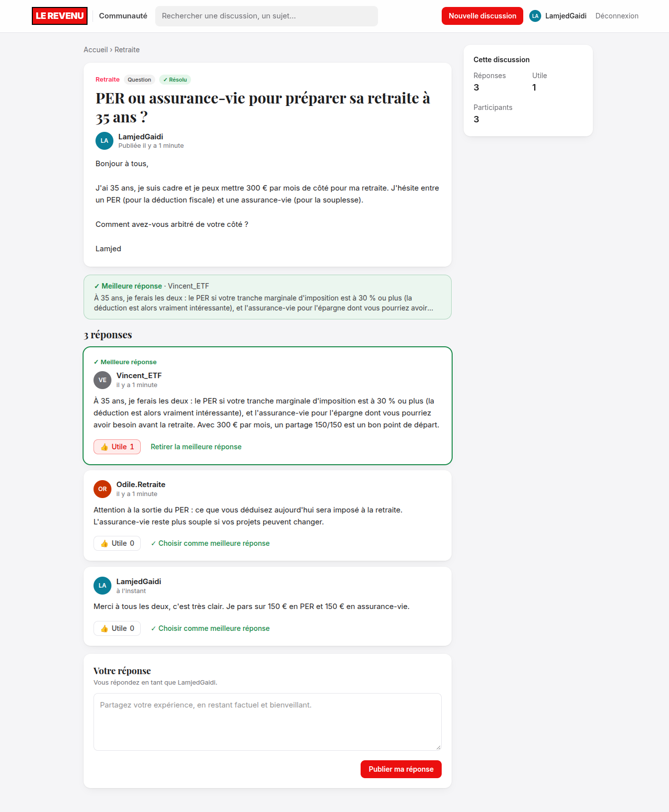 | 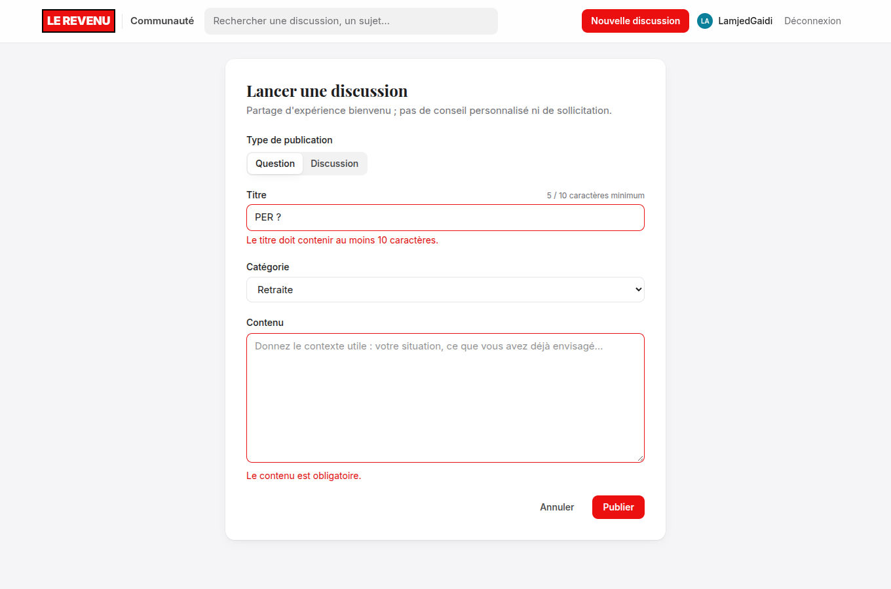 |
| **Connexion (comptes de démo en un clic)** | **Mobile : espaces en défilement, barre basse** |
| 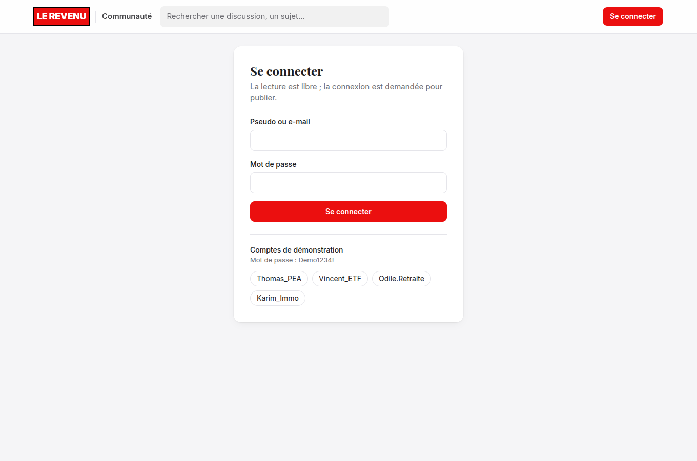 |  |

### Backend (Strapi v5)

| Réponse de l'API (projection publique, pagination) | Permissions du rôle Authenticated (déclarées dans le code) |
| --- | --- |
|  | 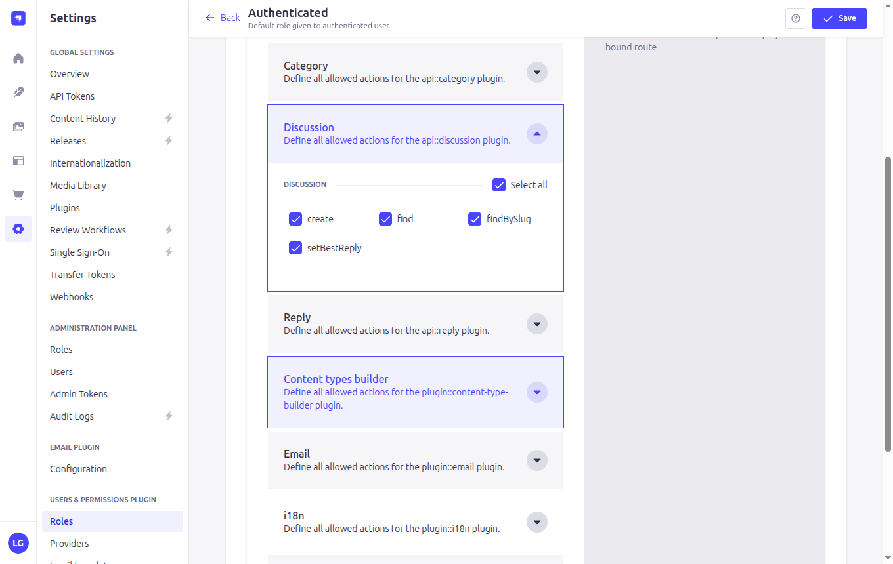 |
| **Content-Type Builder : Discussion** | **Content Manager : discussions** |
| 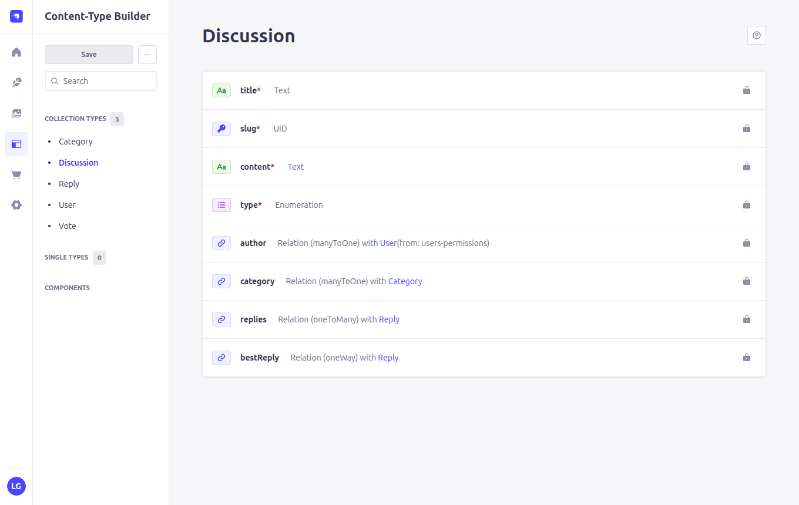 | 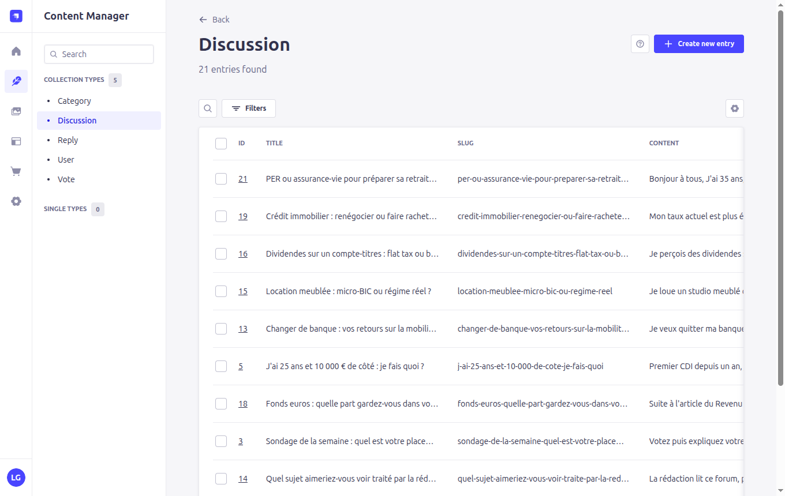 |

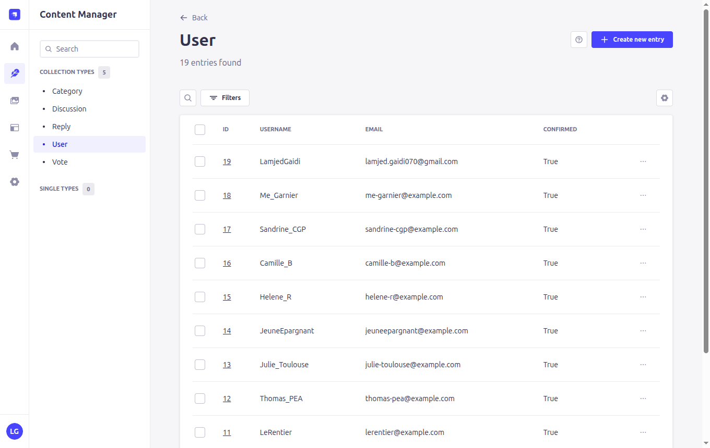

### Base de données (PostgreSQL)

| Table `discussions` | Table `up_users` (mots de passe hachés bcrypt) |
| --- | --- |
| 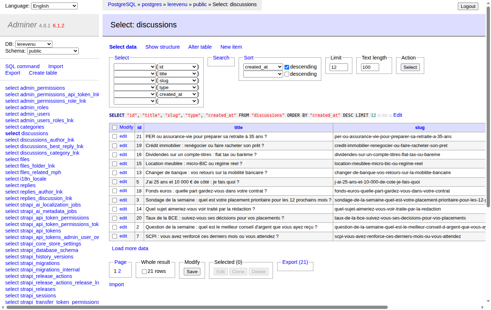 | 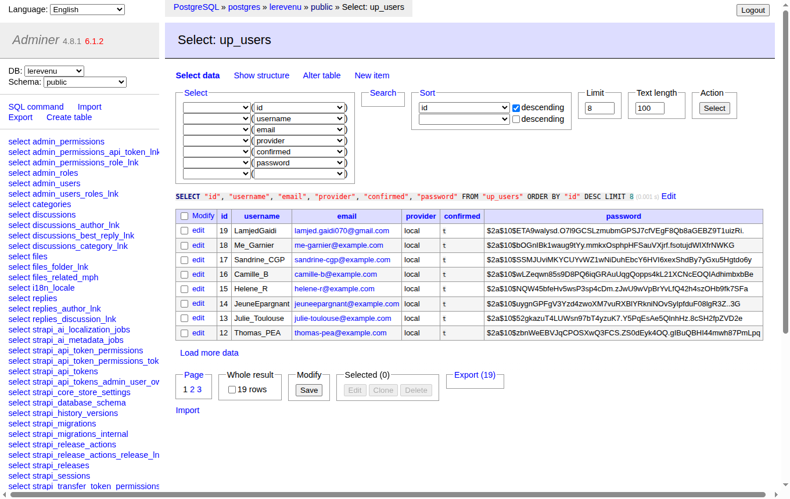 |

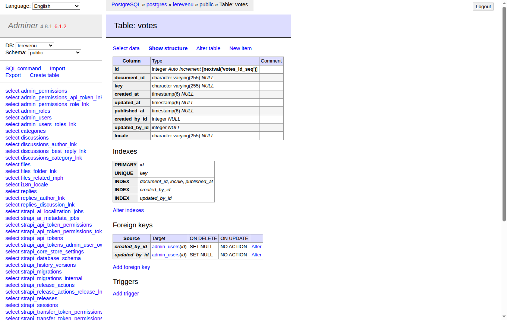

---

## Tests

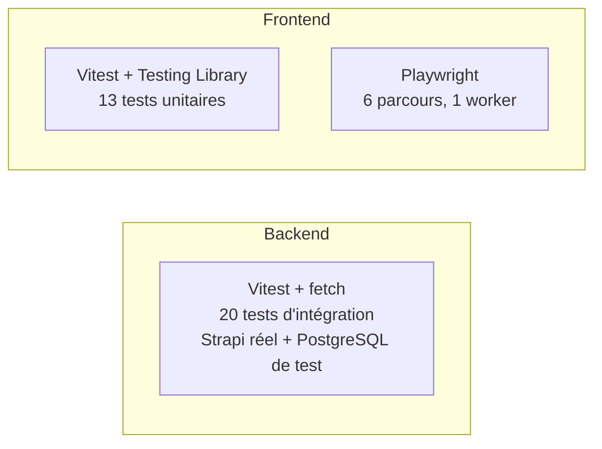

```bash
# Backend : démarre Strapi en mémoire sur la base lerevenu_test (PostgreSQL doit tourner)
cd backend && npm test

# Frontend : composants, validation, client Strapi
cd frontend && npm test

# Bout en bout : l'application doit tourner (docker compose up)
cd frontend && npx playwright install chromium && npm run e2e
```

Ce que couvrent les tests : [`docs/testing.md`](docs/testing.md).

---

## Structure du dépôt

```
.
├── backend/                     Strapi v5
│   ├── config/                  base de données, plugins (JWT), API
│   ├── src/api/
│   │   ├── category/            endpoints natifs (lecture seule)
│   │   ├── discussion/          controller, service, routes, policy, validation
│   │   ├── reply/               controller, service (votes), routes, validation
│   │   └── vote/                content type
│   ├── src/policies/            is-authenticated, is-not-impersonating
│   ├── src/bootstrap/           permissions des rôles
│   ├── src/seed/                données de démonstration (reprises de la maquette)
│   └── tests/                   tests d'intégration HTTP
├── frontend/                    Next.js 16
│   ├── src/app/                 routes, loading / error / not-found
│   ├── src/components/          composants d'affichage et de formulaire
│   ├── src/lib/strapi/          client, requêtes et types de l'API
│   ├── src/lib/actions/         Server Actions
│   ├── tests/unit/              Vitest
│   └── e2e/                     Playwright
├── docker/postgres-init/        création de la base de test
├── docs/                        documentation détaillée et captures
└── docker-compose.yml
```

---

## Documentation détaillée

| Document | Contenu |
| --- | --- |
| [`docs/architecture.md`](docs/architecture.md) | Flux de données, Server vs Client Components, cache et revalidation, gestion des erreurs |
| [`docs/data-model.md`](docs/data-model.md) | Content types, relations, contraintes et index PostgreSQL |
| [`docs/api.md`](docs/api.md) | Endpoints, paramètres, formats de réponse et codes d'erreur (exemples réels) |
| [`docs/security.md`](docs/security.md) | Authentification, permissions, policies, anti-usurpation |
| [`docs/testing.md`](docs/testing.md) | Stratégie et inventaire des tests |
| [`docs/decisions.md`](docs/decisions.md) | Choix techniques, limites connues et pistes d'évolution |
