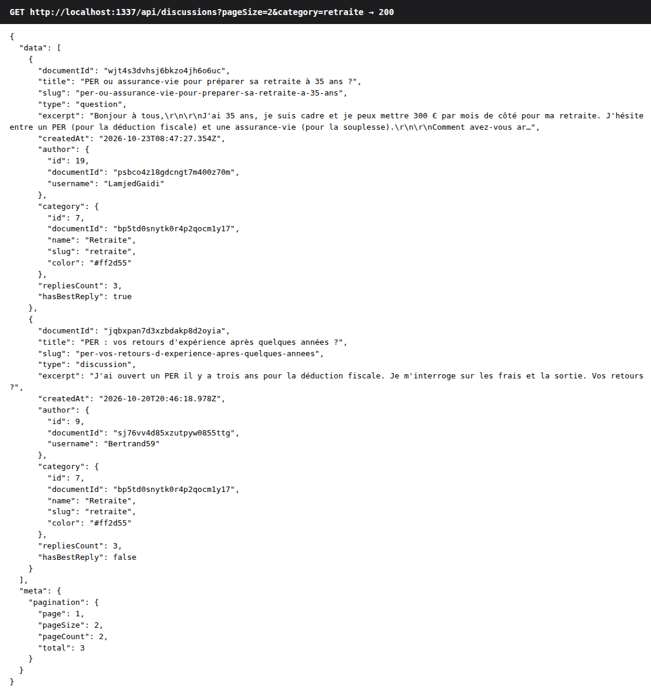

# API Strapi

[← README](../README.md)

Base : `http://localhost:1337/api`. Les réponses suivent le format Strapi `{ data, meta }` en succès et
`{ data: null, error: { status, name, message, details } }` en erreur. Les exemples ci-dessous sont des réponses réelles.

## Endpoints

| Méthode | Route | Accès | Implémentation |
| --- | --- | --- | --- |
| `GET` | `/categories` | Public | natif (`createCoreRouter`) |
| `GET` | `/categories/:id` | Public | natif |
| `GET` | `/discussions` | Public | controller `find` → service `findPublicList` |
| `GET` | `/discussions/slug/:slug` | Public (enrichi si connecté) | controller `findBySlug` |
| `POST` | `/discussions` | Authentifié | controller `create` + policies |
| `PUT` | `/discussions/:id/best-reply` | Auteur de la discussion | controller `setBestReply` + policy `is-discussion-author` |
| `POST` | `/replies` | Authentifié | controller `create` + policies |
| `POST` | `/replies/:id/vote` | Authentifié | controller `vote` (ajoute / retire) |
| `POST` | `/auth/local` | Public | Users & Permissions (renvoie le JWT) |
| `GET` | `/users/me` | Authentifié | Users & Permissions |

Les identifiants `:id` sont les `documentId` de Strapi v5.

## `GET /discussions`

| Paramètre | Défaut | Contraintes |
| --- | --- | --- |
| `page` | `1` | entier ≥ 1 |
| `pageSize` | `10` | entier de 1 à 50 |
| `sort` | `createdAt:desc` | `createdAt:desc` ou `createdAt:asc` uniquement |
| `category` | — | slug de catégorie |
| `q` | — | recherche insensible à la casse dans le titre et le contenu (≤ 100 caractères) |



Un paramètre hors contrat est refusé plutôt qu'ignoré :

```http
GET /api/discussions?sort=title:asc&pageSize=500
```
```json
{
  "data": null,
  "error": {
    "status": 400,
    "name": "ValidationError",
    "message": "Paramètres de liste invalides.",
    "details": { "errors": [
      { "path": ["pageSize"], "message": "pageSize must be less than or equal to 50" },
      { "path": ["sort"], "message": "sort must be one of the following values: createdAt:desc, createdAt:asc" }
    ] }
  }
}
```

## `GET /discussions/slug/:slug`

Renvoie la discussion, ses réponses triées par date croissante, l'identifiant de la meilleure réponse et, pour chaque
réponse, `helpfulCount` et `viewerHasVoted` (vrai si l'utilisateur du JWT a voté).

```json
{
  "data": {
    "documentId": "wjt4s3dvhsj6bkzo4jh6o6uc",
    "title": "PER ou assurance-vie pour préparer sa retraite à 35 ans ?",
    "slug": "per-ou-assurance-vie-pour-preparer-sa-retraite-a-35-ans",
    "type": "question",
    "content": "Bonjour à tous, …",
    "author": { "id": 19, "documentId": "psbco4z18gdcngt7m400z70m", "username": "LamjedGaidi" },
    "category": { "name": "Retraite", "slug": "retraite", "color": "#ff2d55" },
    "bestReplyId": "…",
    "replies": [
      { "documentId": "…", "content": "À 35 ans, je ferais les deux…", "author": { "username": "Vincent_ETF" },
        "helpfulCount": 1, "viewerHasVoted": true }
    ]
  }
}
```

## `POST /discussions`

```http
POST /api/discussions
Authorization: Bearer <jwt>
Content-Type: application/json

{ "data": { "title": "…", "content": "…", "type": "question", "category": "<documentId>" } }
```

Réponses réelles :

```jsonc
// 201 : création ; l'auteur est l'utilisateur du JWT, le slug est généré (suffixe -2, -3… si besoin)

// 403 : visiteur non authentifié (permission du rôle Public absente)
{"data":null,"error":{"status":403,"name":"ForbiddenError","message":"Forbidden","details":{}}}

// 400 : validation métier, une entrée par champ
{"data":null,"error":{"status":400,"name":"ValidationError","message":"Discussion invalide.","details":{"errors":[
  {"path":["title"],"message":"Le titre doit contenir au moins 10 caractères.","value":"PER ?"},
  {"path":["content"],"message":"Le contenu est obligatoire.","value":""},
  {"path":["type"],"message":"Le type doit être « question » ou « discussion ».","value":"sondage"}]}}}

// 403 : tentative de publier au nom d'un autre membre ("author": 2 dans le corps)
{"data":null,"error":{"status":403,"name":"PolicyError","message":"Vous ne pouvez pas publier au nom d’un autre membre.","details":{}}}
```

## `POST /replies`

Corps : `{ "data": { "content": "…", "discussion": "<documentId>" } }`. Mêmes règles que la création de discussion ;
`404 NotFoundError` si la discussion n'existe pas.

## `POST /replies/:id/vote`

Ajoute le vote « Utile » de l'utilisateur, ou le retire s'il existe déjà. Réponse : `{ "data": { "voted": true, "helpfulCount": 4 } }`.
`403 PolicyError` si l'utilisateur vote pour sa propre réponse.

## `PUT /discussions/:id/best-reply`

Corps : `{ "data": { "reply": "<documentId>" } }` ou `{ "data": { "reply": null } }` pour retirer.
`403 PolicyError` si l'utilisateur n'est pas l'auteur de la discussion, `400` si la réponse appartient à une autre
discussion, `404` si la discussion n'existe pas.

## Convention des codes HTTP

| Code | Quand |
| --- | --- |
| `200` / `201` | Lecture / création réussie |
| `400 ValidationError` | Entrée invalide ; `details.errors[]` donne le champ (`path`) et le message |
| `401 UnauthorizedError` | JWT invalide ou expiré |
| `403 ForbiddenError` | Action non permise au rôle (ex. visiteur qui publie) |
| `403 PolicyError` | Règle métier refusée, avec un message explicite (usurpation, vote sur sa réponse, meilleure réponse) |
| `404 NotFoundError` | Discussion ou réponse inexistante |
