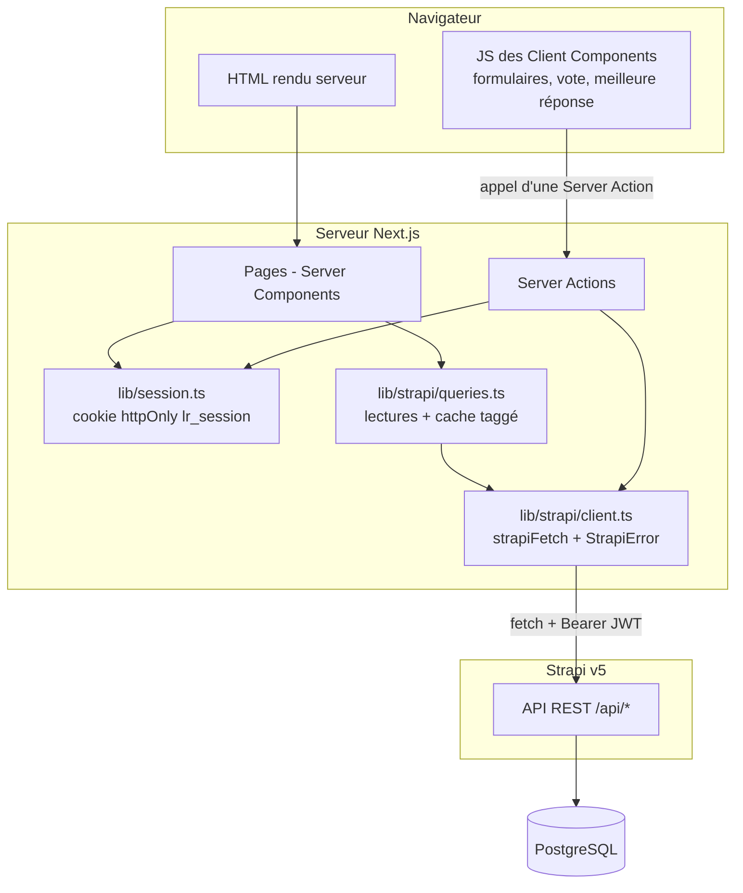
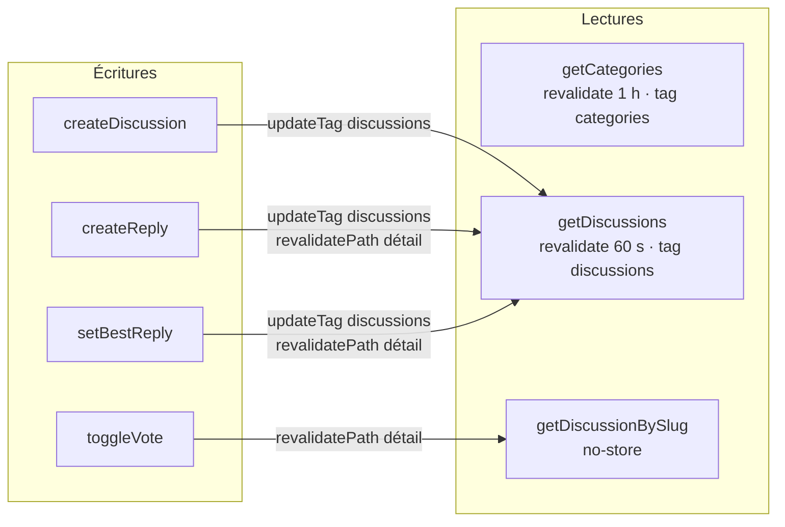
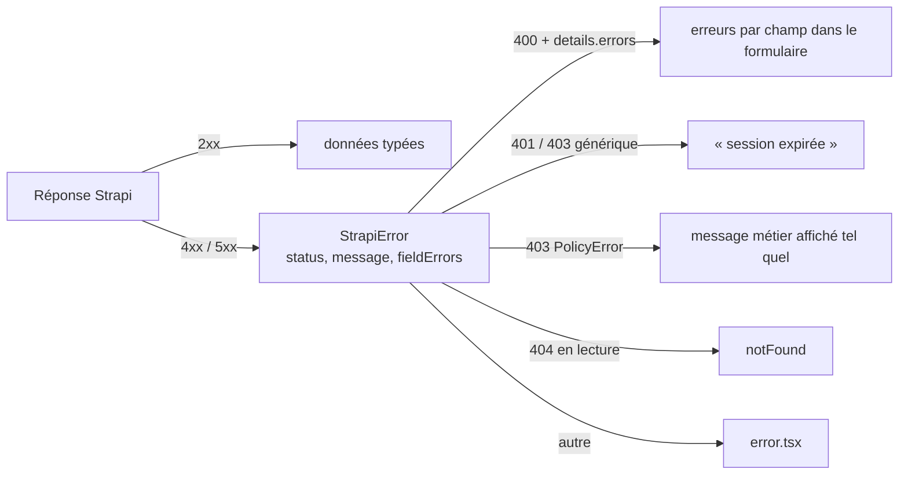

# Architecture

[← README](../README.md)

## Vue d'ensemble

Trois règles structurent le code :

1. **Un seul point d'accès à Strapi** : `frontend/src/lib/strapi/client.ts`, marqué `server-only`. L'URL interne de
   Strapi (`STRAPI_URL`) et le JWT ne sont jamais envoyés au navigateur.
2. **Strapi détient toutes les règles métier.** Les Server Actions valident pour l'ergonomie, transmettent le JWT et
   traduisent les erreurs ; Strapi revalide, autorise et persiste.
3. **L'URL est l'état de l'accueil** : catégorie, recherche, tri et page sont des paramètres d'URL (`?category=bourse&q=PEA&sort=createdAt:asc&page=2`).
   Les liens et le formulaire de recherche sont de simples `<Link>` et `<Form>` : l'accueil fonctionne sans JavaScript
   et chaque vue est partageable.

## Server Components et Client Components

| Composant | Type | Pourquoi |
| --- | --- | --- |
| `app/page.tsx` (accueil) | Server | Lit `searchParams`, appelle Strapi en parallèle (catégories + discussions) |
| `app/discussions/[slug]/page.tsx` | Server | Données à jour à chaque requête, dépend de l'utilisateur (ses votes, ses droits) |
| `components/layout/Header.tsx` | Server | Lit la session (cookie) pour afficher « Se connecter » ou le membre |
| `DiscussionCard`, `ReplyCard`, `CategoryNav`, `Pagination`, `EmptyState` | Server | Affichage pur, aucun JavaScript envoyé |
| `NewDiscussionForm`, `ReplyForm`, `LoginForm` | Client | `useActionState` : état de soumission, erreurs par champ |
| `VoteButton` | Client | `useOptimistic` : le compteur change instantanément, Strapi confirme |
| `BestReplyButton` | Client | `useTransition` : action asynchrone sans bloquer l'interface |
| `error.tsx`, `global-error.tsx` | Client | Imposé par Next.js (bouton « Réessayer ») |

Seuls 7 fichiers portent `"use client"` ; le reste ne charge aucun JavaScript côté navigateur.

## Récupération des données et actualisation

- **Catégories** : quasi statiques, cache d'une heure.
- **Liste des discussions** : cache de 60 secondes, étiqueté `discussions`. Chaque écriture faite depuis l'application
  appelle `updateTag("discussions")` : l'auteur voit immédiatement sa discussion (lecture de ses propres écritures).
  Les modifications faites ailleurs (admin Strapi) apparaissent au plus tard après 60 secondes.
- **Détail** : `cache: "no-store"`. La page contient l'état propre à l'utilisateur (`viewerHasVoted`) et les réponses
  doivent être fraîches. `getDiscussionBySlug` est enveloppé dans `React.cache` pour que `generateMetadata` et la page
  ne déclenchent qu'un appel.
- **Utilisateur courant** : `getCurrentUser` vérifie le JWT auprès de `GET /api/users/me`, une fois par rendu (`React.cache`).

Le projet utilise le modèle de cache par `fetch` (options `next.revalidate` / `next.tags`). Le mode `cacheComponents`
proposé par défaut par `create-next-app` a été désactivé : toutes les pages lisent la session ou les paramètres d'URL et
sont donc dynamiques ; le modèle par `fetch` suffit et reste plus simple à expliquer (voir [`decisions.md`](decisions.md)).

## États de chargement, d'erreur et d'absence de données

| Situation | Rendu |
| --- | --- |
| Chargement de l'accueil / d'une discussion | `loading.tsx` : squelettes aux dimensions des cartes (streaming) |
| Strapi indisponible ou réponse invalide | `error.tsx` : message et bouton « Réessayer » (`retry()`) ; `global-error.tsx` si l'en-tête échoue |
| Discussion inconnue | `notFound()` → `not-found.tsx` |
| Aucune discussion (filtre ou recherche) | `EmptyState` avec lien « Voir toutes les discussions » |
| Discussion sans réponse | « Aucune réponse pour l'instant » + compteur en pointillés rouges sur la carte |
| Erreur de validation | Message sous chaque champ (`aria-invalid`, `aria-describedby`) |
| Session expirée pendant une action | « Votre session a expiré, reconnectez-vous. » |

## Traitement des erreurs Strapi côté frontend

`StrapiError` transforme `error.details.errors[].path` en dictionnaire `{ champ: message }` : le formulaire affiche
les messages de Strapi sous les bons champs, sans dupliquer la logique.
