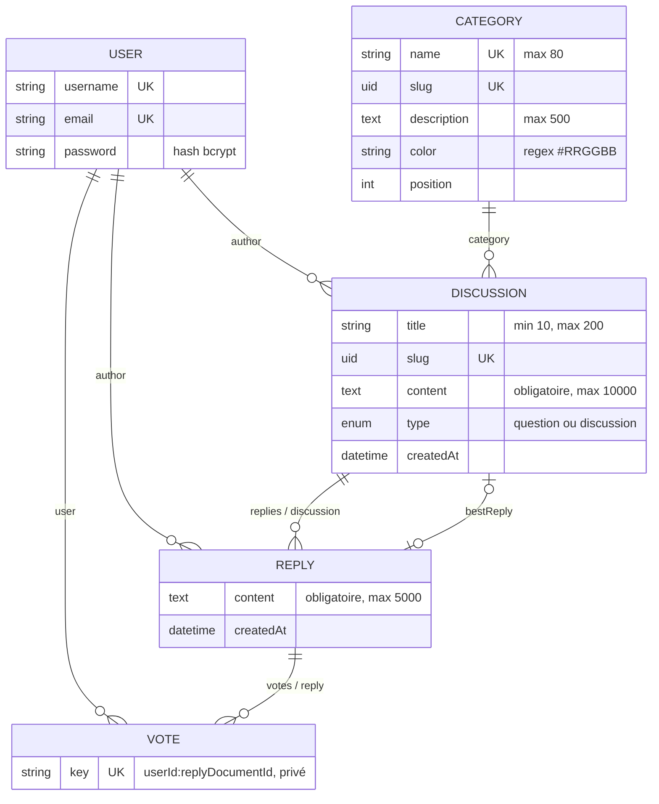

# Modèle de données

[← README](../README.md)

Les schémas sont versionnés dans `backend/src/api/*/content-types/*/schema.json`. `draftAndPublish` est désactivé :
une discussion est visible dès sa création, la « date de publication » affichée est `createdAt`.



## Content types

| Content type | Attributs | Relations |
| --- | --- | --- |
| **User** (`plugin::users-permissions.user`) | modèle du plugin Users & Permissions, inchangé | — |
| **Category** | `name` (unique), `slug` (uid), `description`, `color`, `position` | `discussions` (oneToMany) |
| **Discussion** | `title` (10–200), `slug` (uid unique), `content`, `type` (`question` \| `discussion`) | `author` → User, `category` → Category, `replies` → Reply, `bestReply` → Reply |
| **Reply** | `content` (≤ 5000) | `author` → User, `discussion` → Discussion, `votes` → Vote |
| **Vote** | `key` (unique, privé) | `user` → User, `reply` → Reply |

`Vote` n'expose aucune route : il n'est manipulé que par le service `reply.toggleVote`.

## Contraintes et index PostgreSQL

Dans Strapi v5, chaque relation est stockée dans une table de liaison (`discussions_author_lnk`,
`replies_discussion_lnk`…). Une contrainte composite « un vote par membre et par réponse » ne peut donc pas porter
sur deux colonnes de la table `votes`. Elle est obtenue avec une colonne scalaire `key = "userId:replyDocumentId"`
couverte par un index unique.

Les index sont déclarés dans les schémas (clé `indexes`), Strapi les crée et les maintient lors de la synchronisation :

| Table | Index | Rôle |
| --- | --- | --- |
| `votes` | `votes_key_unique` UNIQUE (`key`) | Un seul vote par membre et par réponse, même en cas de requêtes concurrentes |
| `discussions` | `discussions_slug_unique` UNIQUE (`slug`) | URL unique, recherche par slug indexée |
| `discussions` | `discussions_created_at_index` (`created_at`) | Tri par date de publication |
| `*_lnk` | index et contrainte unique générés par Strapi | Jointures auteur / catégorie / discussion |


## Récupération optimisée des relations

La liste des discussions est obtenue avec **une requête de lecture et une requête de comptage** :

```ts
strapi.documents("api::discussion.discussion").findMany({
  filters, sort, start, limit,
  fields: ["title", "slug", "type", "content", "createdAt"],
  populate: {
    author: { fields: ["username"] },
    category: { fields: ["name", "slug", "color"] },
    bestReply: { fields: ["documentId"] },
    replies: { count: true },          // COUNT SQL, pas de chargement des réponses
  },
});
```

- `fields` limite les colonnes lues ; l'auteur ne remonte que son pseudo.
- `replies: { count: true }` produit un comptage SQL au lieu de charger toutes les réponses (pas de N+1).
- Le détail charge les réponses avec leur auteur et le **nombre** de votes (`votes: { count: true }`), puis les votes
  de l'utilisateur courant en **une** requête (`key IN (...)`).

## Données de démonstration

`backend/src/seed/demo-data.json` reprend la maquette : 11 catégories (avec leurs couleurs), 18 membres et
20 discussions avec réponses, votes et 3 meilleures réponses. `src/seed/index.ts` les crée au démarrage si la base
est vide (`SEED_DEMO=true`), en antidatant les contenus pour que les dates relatives soient réalistes. Les mots de passe
sont hachés par le Document Service (bcrypt, voir la capture de `up_users`).
