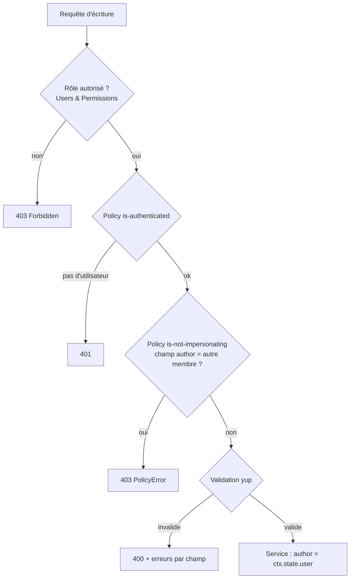

# Sécurité, utilisateurs et permissions

[← README](../README.md)

## Authentification

- Comptes gérés par le plugin **Users & Permissions** de Strapi. Le frontend appelle `POST /api/auth/local` depuis une
  Server Action ; le JWT renvoyé (validité 7 jours, `JWT_EXPIRES_IN`) est stocké dans un cookie **`httpOnly`**,
  `SameSite=Lax`, `Secure` en production. Il n'est jamais lisible par le JavaScript du navigateur.
- À chaque rendu, le serveur Next.js vérifie le jeton auprès de `GET /api/users/me` ; un jeton expiré est traité comme
  un visiteur.
- La redirection après connexion n'accepte que des chemins internes (`/…`, pas `//…`) pour éviter les redirections ouvertes.
- La connexion est limitée par le plugin (10 tentatives par minute par défaut, `AUTH_RATELIMIT_MAX`).

## Autorisations : trois niveaux, tous dans Strapi

1. **Permissions des rôles**, déclarées dans `backend/src/bootstrap/permissions.ts` et appliquées à chaque démarrage :

   | Action | Public | Authenticated |
   | --- | :---: | :---: |
   | `category.find` / `findOne` | ✅ | ✅ |
   | `discussion.find` / `findBySlug` | ✅ | ✅ |
   | `discussion.create` | ❌ | ✅ |
   | `discussion.setBestReply` | ❌ | ✅ (+ policy auteur) |
   | `reply.create` / `reply.vote` | ❌ | ✅ |

   Si une écriture était accordée par erreur au rôle Public depuis l'admin, elle serait retirée au redémarrage.

2. **Policies** (défense en profondeur) :
   - `global::is-authenticated` : aucune route d'écriture ne s'exécute sans utilisateur, même si un rôle est mal configuré ;
   - `global::is-not-impersonating` : refuse explicitement un champ `author` désignant un autre membre ;
   - `api::discussion.is-discussion-author` : seul l'auteur choisit la meilleure réponse.

3. **Services** : l'auteur est **toujours** `ctx.state.user`, jamais une valeur du corps de la requête. Même sans la
   policy, il serait impossible de publier au nom d'un autre.

Les refus métier utilisent `PolicyError` : c'est la seule erreur 403 dont Strapi conserve le message dans la réponse
HTTP (les autres `ForbiddenError` sont réduites à « Forbidden » par le middleware d'autorisation).

## Données exposées

- Les listes et le détail sont des **projections explicites** : l'auteur n'expose que `id`, `documentId`, `username`.
  L'e-mail n'est jamais renvoyé.
- Le rôle Public **n'a pas** la permission `users-permissions.user.find` : `GET /api/users` répond 403. C'est la raison
  pour laquelle les endpoints de lecture des discussions sont personnalisés (voir [`decisions.md`](decisions.md)).
- `Vote.key` est un attribut `private`.
- Les paramètres de liste sont validés (tri sur liste blanche, taille de page plafonnée à 50) : impossible de demander
  un tri sur un champ arbitraire ou de vider la base en une requête.

## Secrets

- Aucun secret n'est versionné : `backend/.env.example` et `frontend/.env.example` ne contiennent que des valeurs à remplacer.
- `docker-compose.yml` fournit des valeurs de démonstration pour un lancement local immédiat ; elles se surchargent
  par variables d'environnement.
